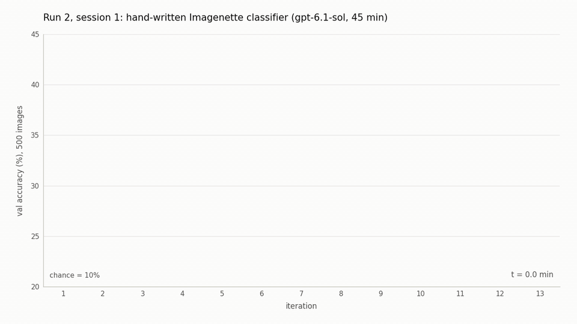

# Codex hand-writes an Imagenette classifier (run 2, session 1)

This experiment is early evidence that AI agents can optimise tasks that were considered solvable only by neural networks: here, image classification. Specifically, we let a Codex agent (`gpt-6.1-sol`, high reasoning effort) write a classifier for 10-class Imagenette as plain Python code, with no training and no learned parameters. The agent is not allowed to use statistical learning. In one 45-minute `codex exec` session its program reached 41.4% on a held-out test set of 2,000 images, against 10% chance and 75.45% for a small CNN trained on the same images. There is still a long way to go, but the result is encouraging and we expect it to improve.



[mp4](media/val_vs_iteration.mp4)

## Setup

- 2026-11-03, Codex CLI 0.166.0: `codex exec -C workspace -m gpt-6.1-sol -c model_reasoning_effort=high -s workspace-write --json`, under a 45-minute `timeout` (the session ended at the wall cap).
- Task: write one file, `workspace/classify.py`, using only numpy, PIL, scipy, hand-designed OpenCV calls and the stdlib, at most 5 s per image. One hard rule, "no statistical learning": no fitting, no automated search, no stored statistics, no pretrained components; every constant hand-chosen and commented. Full rules in `workspace/AGENTS.md`, task brief in `workspace/BRIEF.md`.
- Data: Imagenette2-160. The agent sees 500 train + 500 val images (50 + 50 per class, seeded, listed in `data/manifest.json`). A 2,000-image test set from Imagenette's val split is never visible to the agent.
- Feedback loop: `check.py` reports train/val accuracy; `look.py` shows an image as a text description from a vision model (DeepSeek free tier, Claude Haiku fallback). Any val image the agent views is moved to train.
- Outside the agent's view: a Claude Haiku judge reviews every saved version of `classify.py` against the rules; a budget monitor would stop Codex at 90% of its rate-limit window (it did not fire). No teacher model, no consultant, no sub-agents in this session.
- Result: 13 measured iterations; val 24.8% -> peak 41.6% (it. 6) -> 40.8% (it. 13); train 42.6% at the end.
- Test (scored after the fact, for this write-up): iteration 13 = 41.40% (828/2000), iteration 11 (the version the agent kept) = 40.35% (807/2000).
- The full run continued for three more sessions and reached 47.85% on the test set (see the main repo, linked below).

## Replicate

Prerequisites: `codex` CLI >= 0.166 (logged in), `claude` CLI (logged in), optionally `opencode` for the DeepSeek viewer, ffmpeg, Python 3.10+. If the binaries are not on `PATH`, point `OPENCODE_BIN` / `CLAUDE_BIN` at them. A real run spends Codex rate limit (about 22% of a 5-hour window in the original).

```sh
pip install -r requirements.txt
python3 -m venv judge/.venv && judge/.venv/bin/pip install claude-agent-sdk

# data: download and extract https://s3.amazonaws.com/fast-ai-imageclas/imagenette2-160.tgz, then
python3 scripts/build_data.py --src /path/to/imagenette2-160 --test      # 500 / 500 / 2000 images

# daemons (keep running during the session)
nohup python3 looker/daemon.py >> looker.stdout 2>&1 &
nohup judge/.venv/bin/python judge/watch.py >> judge.stdout 2>&1 &

# the 45-minute session
scripts/run_driver.sh full --reset-views

# audit the session and score the result on the hidden test set
python3 scripts/audit.py out/full/events.jsonl --looker out/looker.jsonl --judge out/judge.jsonl
python3 workspace/check.py workspace/classify.py --images test --no-exclude

# replay the original program on the original val set (expect 0.404)
python3 workspace/check.py run/iterations/_iteration11.py --images workspace/data/val --no-exclude
```

## What is in run/

- `events.jsonl`: the Codex `--json` event stream of the session. `rollout_session1.jsonl`: the Codex session rollout, lines of session 1 only, account ids redacted.
- `budget.jsonl`, `judge.jsonl`, `looker.jsonl`, `driver.log`, `codex_stderr.log`, `run_meta.json`, `session_id`: budget monitor, judge, viewer and driver logs. `brief_rendered.md`: the prompt as given to Codex.
- `NOTES.md`: the agent's own notes. `iterations/_iteration{7..13}.py`: snapshots 7-13 saved by the agent. `classify_end_of_session.py`: the file on disk at the wall cap (iteration 11 mid-cleanup, unmeasured).
- `checks/`: `check.py` outputs per iteration (`train{N}`, `val{N}`, `analysis*`) plus the two test scores (`test11`, `test13`). `iterations.csv`: one row per iteration (made by `scripts/extract_iterations.py`).
- The original home directory in paths was rewritten to `/home/user` in all of these files.

## Video

`python3 scripts/make_video.py --csv run/iterations.csv --out media/val_vs_iteration` (needs matplotlib and ffmpeg; writes the mp4 and the gif).

Main project, with all six runs, baselines and analysis: https://github.com/Ido-Zuk-Git/weightspace-imagenette
